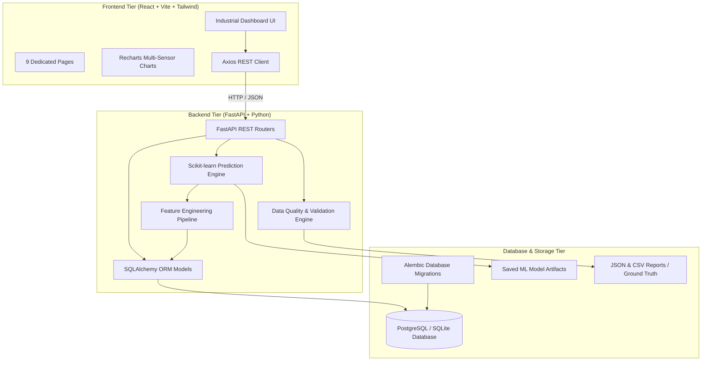

# System Architecture — AI-Based Predictive Maintenance System

## 1. Clean Architecture Overview

The system adheres to a strict separation of concerns across three isolated layers:

---

## 2. Layer Responsibilities

### Frontend Layer (`frontend/`)
- Built with **React 18**, **Vite**, **Tailwind CSS**, and **Lucide React**.
- Consumes backend REST endpoints via Axios client.
- Zero business logic and zero hardcoded metrics: all status badges, probability percentages, failure counts, and health charts are driven dynamically by the backend API.
- Implements 9 modular views:
  1. Executive Monitoring Dashboard
  2. Plant & Production Line Management
  3. Machine Real-Time Telemetry & Sensor Monitoring
  4. Failure Prediction & Explainable AI Factor Weights
  5. Alerts & Edge Case Exceptions Management
  6. Maintenance Work Order & Spare Parts Allocation
  7. Historical Machine Breakdown Analysis
  8. Machine Learning Model Performance & Metrics
  9. Data Quality & Automated Validation Suite

### Backend Layer (`backend/`)
- Built with **Python 3.11/3.13**, **FastAPI**, **Pydantic v2**, and **SQLAlchemy 2.0**.
- OpenAPI / Swagger documentation exposed at `/docs` and `/redoc`.
- Asynchronous connection pool management with automatic graceful fallback between PostgreSQL and SQLite.
- Strict Pydantic request/response validation with HTTP status codes and error handlers.

### Machine Learning Engine (`backend/app/ml/`)
- **Feature Engineering**: Vectorized window extraction calculating 24h temperature averages, peak temperatures, vibration levels, vibration trends (6h vs 24h ratio), pressure instability, current fluctuations, accumulated run hours, and historical failure counts.
- **Model Training**: Chronological train/test split (75% early train, 25% holdout test) eliminating lookahead data leakage.
- **Algorithms**: Random Forest Champion (120 trees, balanced class weights) compared against Logistic Regression.
- **Explainability**: Quantifies individual feature deviations against baseline and computes percentage attribution for operator transparency.

### Database Layer (`database/`)
- PostgreSQL DDL (`schema.sql`) and Alembic migration scripts (`001_initial_schema.py`).
- 10 main business entities with immutable IDs, cascade rules, and compound B-tree indexes for time-series range lookups.

---

## 3. Data Flow & Inference Lifecycle

1. **Ingestion**: Telemetry is streamed or generated into `telemetry_events`.
2. **Quality Audit**: The `DataValidator` continuously checks incoming events for unknown sensors, out-of-range physical values, inverted maintenance timestamps, and masked zeros.
3. **Feature Extraction**: When inference is requested, `FeatureExtractor` compiles the recent 24-hour observation window for the target machine.
4. **Prediction**: The trained Random Forest model calculates failure probability within the next 24 hours.
5. **Categorization**: Probabilities are mapped into Low Risk (<35%), Medium Risk (35-70%), and High Risk (>70%).
6. **Persistence**: Inferences are logged to `failure_prediction_logs` and machine health scores are updated dynamically.
7. **Action**: If a machine reaches High Risk, an emergency work order can be created directly from the dashboard, allocating technicians and replacement parts.
