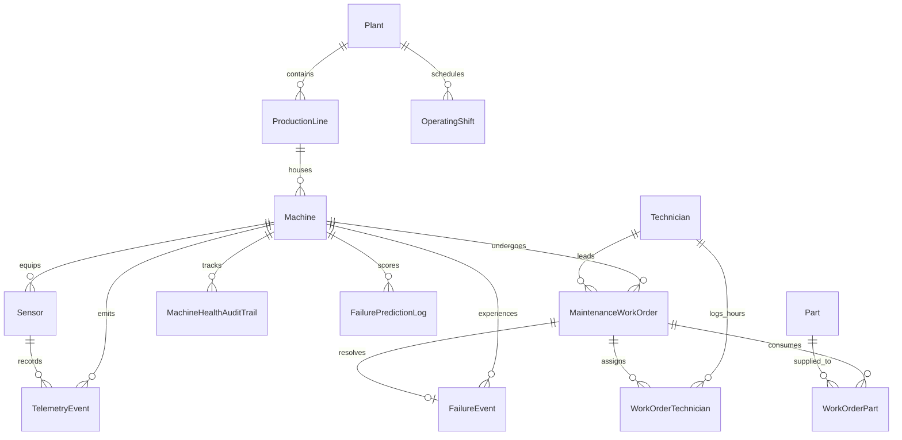

# Database Architecture & Design — Predictive Maintenance System

## 1. Entity-Relationship Overview

The database is designed with 10 primary entities, 2 many-to-many bridge tables, and 3 audit/data-quality tables.

---

## 2. Relationships and Cardinalities

1. **`Plant` to `ProductionLine` (1:N)**: One plant operates multiple production lines. Cascade delete enforced.
2. **`ProductionLine` to `Machine` (1:N)**: A production line contains 8 to 9 industrial machines.
3. **`Machine` to `Sensor` (1:N)**: Each machine is equipped with 5 specialized sensors (`TEMPERATURE`, `VIBRATION`, `PRESSURE`, `CURRENT`, `RPM`).
4. **`Sensor` to `TelemetryEvent` (1:N)**: High-frequency time-series measurements reference the sensor and machine.
5. **`Machine` to `MaintenanceWorkOrder` (1:N)**: Machines receive preventive and corrective maintenance.
6. **`Technician` to `MaintenanceWorkOrder` (1:N & N:M)**:
   - A technician can lead a work order (`lead_technician_id`).
   - Multiple technicians can log labor hours on a work order via the `work_order_technicians` bridge table.
7. **`Part` to `MaintenanceWorkOrder` (N:M)**:
   - Parts consumed during maintenance are tracked in `work_order_parts`, capturing the unit cost at the time of repair and deducting stock from inventory.
8. **`Machine` to `FailureEvent` (1:N)**: Each machine can experience recorded failure events.
9. **`FailureEvent` to `MaintenanceWorkOrder` (1:1 / 1:0)**: When a failure occurs, an emergency or corrective work order is linked.

---

## 3. ID Conventions & Immutability Rules

Every entity uses a deterministic, human-readable primary key:

| Entity | ID Pattern | Sample |
| :--- | :--- | :--- |
| **Plant** | `PLT-{###}` | `PLT-001` |
| **ProductionLine** | `LINE-{PlantID}-{###}` | `LINE-PLT-001-001` |
| **Machine** | `MCH-{LineID}-{###}` | `MCH-LINE-PLT-001-001-001` |
| **Sensor** | `SNS-{MachineID}-{TYPE}-{##}` | `SNS-MCH-LINE-PLT-001-001-001-TEMP-01` |
| **Telemetry** | `TEL-{SensorID}-{YYYYMMDDHHMMSS}` | `TEL-SNS-...-20261022120000` |
| **Shift** | `SHF-{PlantID}-{YYYYMMDD}-{CODE}` | `SHF-PLT-001-20261022-MORN` |
| **Work Order** | `WO-{YYYY}-{######}` | `WO-2026-000001` |
| **Failure Event** | `FAIL-{YYYY}-{######}` | `FAIL-2026-000001` |
| **Technician** | `TECH-{###}` | `TECH-001` |
| **Part** | `PRT-{####}` | `PRT-0001` |
| **Validation Exception** | `VAL-{TYPE}-{TIMESTAMP}-{COUNTER}` | `VAL-FAIL-20261111-00001` |

---

## 4. Indexing & Query Optimization

- **Compound Index on Telemetry**:
  - `idx_telemetry_sensor_timestamp ON telemetry_events(sensor_id, timestamp DESC)`
  - `idx_telemetry_machine_timestamp ON telemetry_events(machine_id, timestamp DESC)`
  - Enables sub-millisecond retrieval of multi-sensor chart time-series without full table scans.
- **Anomaly Filter Index**:
  - `idx_telemetry_is_anomaly ON telemetry_events(is_anomaly)`
- **Foreign Key Indexes**:
  - All foreign keys (`plant_id`, `line_id`, `machine_id`, `work_order_id`, `lead_technician_id`) are indexed to support rapid relational joins and cascade safety.

---

## 5. Audit Trails & Non-Overwriting Principle

- **Historical Machine Health**: The `machine_health_audit_trail` table records every status transition (`OPERATIONAL` -> `DEGRADED` -> `FAILED` -> `OPERATIONAL`) and health score fluctuation with its triggering event and timestamp.
- **Failure Predictions**: The `failure_prediction_logs` table preserves every ML inference output along with its JSON-encoded factor weights and recommendations, enabling tracking of model drift over time.
- **Data Validation Exceptions**: Out-of-range sensor values, unknown sensors, and inverted timestamps are never silently dropped; they are preserved with explicit diagnostic metadata in `data_validation_exceptions`.
